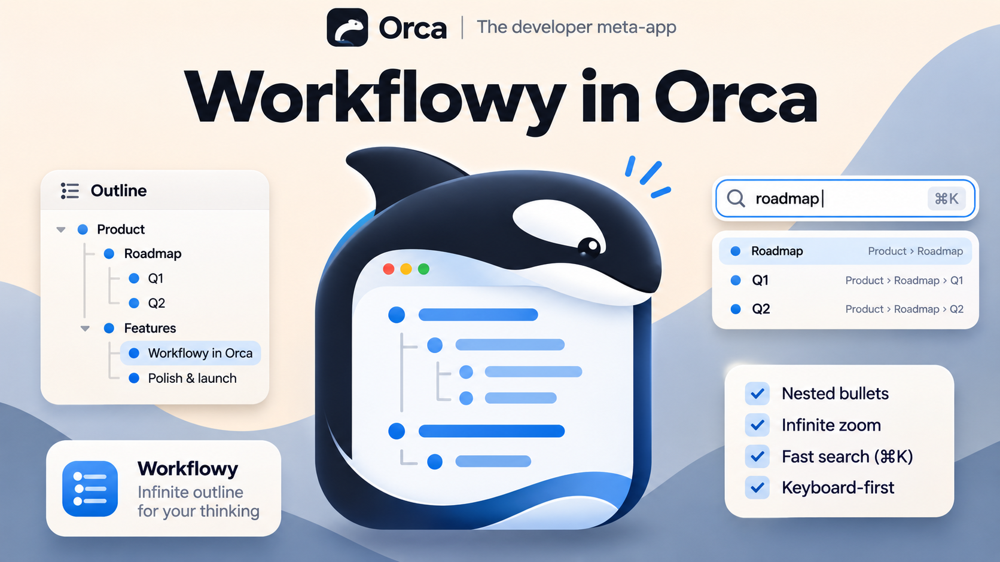
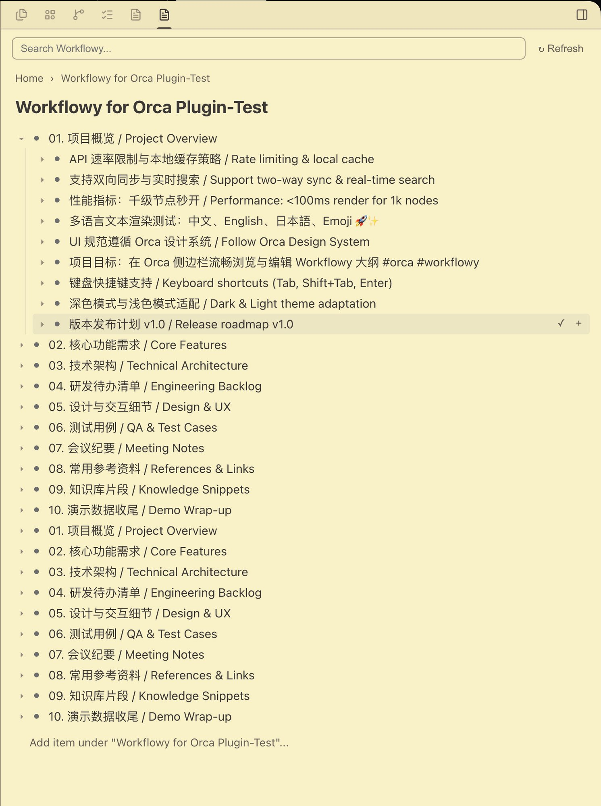

# Workflowy in Orca

[English](README.md) | [中文文档](README.zh-CN.md)

Browse, search, and edit your **Workflowy** outline directly inside the **Orca** sidebar.

## Features

- **1:1 Workflowy Experience**: Clean bullet-list typography, tree guide lines, and theme adaptation (Light & Dark).
- **Zoom Focus Mode**: Click any bullet dot (`•`) to zoom into a node with breadcrumb navigation (`Home › ...`).
- **Inline Editing**: Click any node text to edit inline (`Enter` to save, `Esc` to cancel).
- **Drag & Drop**: Drag a bullet dot to reorder siblings or nest under another node.
- **Quick Actions**: Expand/collapse lazily, toggle completion (`✓`), add child nodes (`+`), and real-time search.
- **Local Cache & Auto Sync**: Cached via `orca.storage` for instant startup, manual sync (`↻ Sync`), and configurable auto-refresh interval (Off, 5m, 15m, 30m, 1h).

## Screenshot

## Setup

1. Generate your personal API key at [workflowy.com/api-key](https://workflowy.com/api-key/).
2. Open **Orca Settings → Plugins → Workflowy**.
3. Paste your **Workflowy API Key** (and optionally set a **Root Node ID** to scope the sidebar to a specific node).
4. Open the **Workflowy** panel in the Orca sidebar.

## License

[MIT](LICENSE)

> Disclaimer: This plugin is an independent community-built project and is not affiliated with, endorsed by, or associated with Orca or Workflowy.
