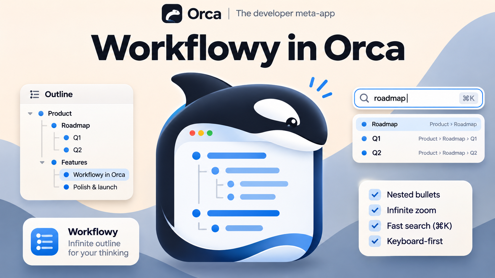
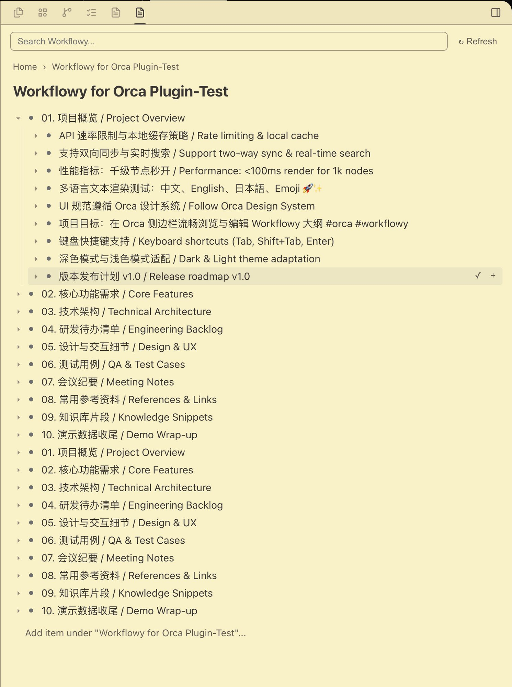

# Workflowy in Orca

[English](README.md) | [中文文档](README.zh-CN.md)

在 **Orca** 侧边栏中直接浏览、搜索和编辑你的 **Workflowy** 大纲。

## 核心功能

- **1:1 Workflowy 体验**：还原无衬线排版、树形引导线，并自动适配 Orca 明暗主题。
- **Zoom 聚焦模式**：点击任意节点前的圆点（`•`）即可聚焦进入该节点，顶部支持面包屑导航（`Home › ...`）。
- **行内编辑**：直接点击节点文本即可编辑（`Enter` 保存，`Esc` 取消）。
- **鼠标拖拽排序**：按住节点圆点拖拽，支持同级排序或拖入成为子节点。
- **快捷操作**：按需懒加载展开/折叠、标记完成（`✓`）、新增子节点（`+`）以及实时搜索过滤。
- **本地缓存**：通过 `orca.storage` 本地缓存实现秒开，支持点击右上角 `↻ Sync` 手动同步。

## 效果截图

## 安装与配置

1. 前往 [workflowy.com/api-key](https://workflowy.com/api-key/) 生成你的个人 API Key。
2. 打开 **Orca Settings → Plugins → Workflowy**。
3. 粘贴你的 **Workflowy API Key**（可选填写 **Root Node ID** 以限定侧边栏只显示指定节点）。
4. 在 Orca 右侧边栏打开 **Workflowy** 面板即可使用。

## 开源协议

[MIT](LICENSE)

> 免责声明：本插件与 Orca 和 Workflowy 均无关系，为社区爱好者作品。
